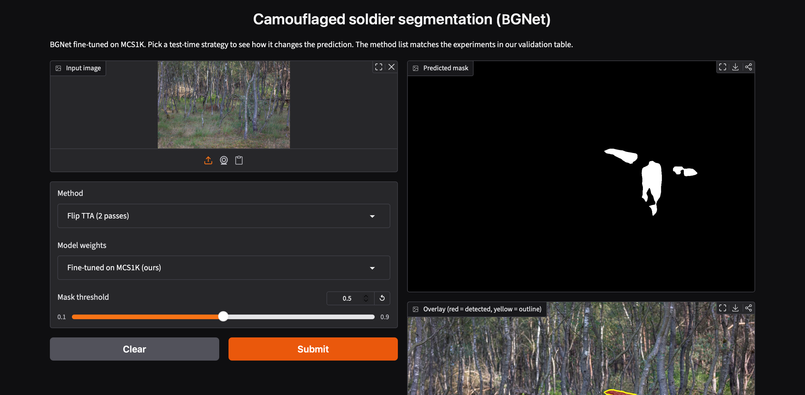

# Finding Camouflaged Soldiers with BGNet

This project teaches a computer to find soldiers who are hiding in camouflage. Given a photo, the model
draws an outline (a "mask") around any camouflaged person it finds, even when the person almost blends into the
background.

We start from **BGNet**, a published camouflaged-object detector, fine-tune it on a dataset of camouflaged soldiers
(MCS1K), and then test whether cheap tricks applied at prediction time (no extra training) can make the results
more accurate, especially on the hardest images.

**Who it's for:** students and researchers working on camouflaged-object detection, and anyone who wants to see
how well a modern segmentation model copes with people who are hard to spot.



## What we found

All numbers use the 330-image MCS1K test split, which the model never trained on. Higher is better for every
column except MAE.

| Model (full test split) | S-measure | Weighted F | MAE (lower is better) |
|---|---|---|---|
| BGNet, authors' weights (no training on MCS1K) | 0.744 | 0.651 | 0.098 |
| BGNet fine-tuned on MCS1K (20 epochs) | **0.860** | **0.806** | **0.049** |

We then built a **hard subset** (the 70 test images with the smallest, lowest-contrast, most irregular targets) and
tried prediction-time strategies on the fine-tuned model:

| Hard subset (70 images) | S-measure | Weighted F | Mean E | Boundary F |
|---|---|---|---|---|
| Pretrained (authors' weights) | 0.717 | 0.572 | 0.778 | 0.415 |
| Fine-tuned | 0.802 | 0.702 | 0.899 | 0.506 |
| + flip averaging | 0.816 | 0.702 | 0.895 | 0.519 |
| + multi-scale + flip averaging | **0.828** | 0.695 | 0.877 | **0.534** |
| + small-blob cleanup | 0.789 | 0.684 | 0.885 | 0.482 |
| + adaptive threshold (binary mask) | 0.793 | 0.705 | 0.905 | 0.499 |

Averaging predictions (flip and multi-scale) improved the shape and boundary scores on both the hard images and the
rest of the test set. Multi-scale gains a little more shape accuracy at a small cost in E-measure and weighted F.
Cleanup and thresholding did not help. Differences of about 0.01 are within noise on 70 images, so see
`validate.py`'s confidence intervals before reading too much into a single row.

## Installation

Tested on **Python 3.13 (Google Colab)**. Training and `etest.py` need an **NVIDIA GPU** because the original BGNet
code calls `.cuda()`. The demo and `validate.py` fall back to the CPU, which works but is slow. Google Colab with a
free T4 GPU is the easiest place to run everything.

```bash
git clone https://github.com/andrew-blankenship/Camouflaged-Object-Segmentation
cd Camouflaged-Object-Segmentation
python -m venv .venv
source .venv/bin/activate          # Windows: .venv\Scripts\activate
pip install -r requirements.txt
```

In Colab, skip the virtual environment: run the `git clone` and `cd` steps, then `pip install -r requirements.txt`.

## Get the data

Dataset: [Military Camouflage Soldiers Dataset (MCS1K)](https://www.kaggle.com/datasets/aalihhiader/military-camouflage-soldiers-dataset-mcs1k)
on Kaggle. It has 748 training and 330 test images, each with a ground-truth mask.

1. Make a free Kaggle account and create an API token (Kaggle → Settings → Create New Token). Put the downloaded
   `kaggle.json` in `~/.kaggle/`, or set the environment variables `KAGGLE_USERNAME` and `KAGGLE_KEY`.
2. Run:
   ```bash
   python scripts/prepare_data.py
   ```

This downloads the dataset and builds the folders the code expects (the Kaggle masks are `.jpg`, so they are
converted to clean black-and-white PNGs, and the boundary maps BGNet trains with are generated from the masks):

```
data/TrainDataset/{Imgs,GT,Edge}     748 training images, masks, boundary maps
data/TestDataset/MCS1K/{Imgs,GT}     330 test images and masks
```

Add `--val_frac 0.15` to also hold out a random, seeded validation set in `data/ValDataset/`. Rerunning the script
rebuilds the folders from scratch. The generated `data/` folders are not stored in this repository.

## Get the model weights

Weights are too large for GitHub (about 306 MB each). Create a `checkpoints/` folder and download:

| File | What it is | Save as |
|---|---|---|
| [Authors' pretrained BGNet](https://drive.google.com/file/d/1RQFRgQNtXYfKW4bm5veU4_4ikgPiuEwl/view?usp=sharing) | Trained by the BGNet authors, not on MCS1K | `checkpoints/BGNet.pth` |
| [Our fine-tuned BGNet](https://drive.google.com/file/d/1sT1bxfyUBFcMjISM81yYhdcsc1dnV_hO/view?usp=sharing) | Authors' weights + 20 epochs on MCS1K | `checkpoints/mcs1k_ft/BGNet-19.pth` |

On Linux/Colab you can fetch a Drive file with `pip install gdown`, then `gdown <file-id> -O checkpoints/BGNet.pth`.

## Run the models

All commands run from the repository root.

**Evaluate a model on the test split** (writes predicted masks to `results/BGNet/MCS1K/` and prints the metrics):
```bash
python etest.py --pth_path checkpoints/mcs1k_ft/BGNet-19.pth
python eval.py
```
Use `--pth_path checkpoints/BGNet.pth` to get the pretrained baseline instead.

**Build the hard subset** (writes `data/TestDataset/MCS1K_hard` and `MCS1K_rest`, plus `hardness.csv`):
```bash
python build_hard_set.py --n 70
```
Hardness comes only from the image and its mask (object size, contrast with the background, outline complexity),
never from a model's mistakes, so no method gets an unfair advantage.

**Compare methods on the hard subset** (prints one table and saves CSVs to `validate_out/`):
```bash
python validate.py --ckpt checkpoints/mcs1k_ft/BGNet-19.pth --pretrained checkpoints/BGNet.pth --subsets MCS1K_hard
python validate.py --ckpt checkpoints/mcs1k_ft/BGNet-19.pth --subsets MCS1K_rest --methods ft+tta_flip ft+tta_ms
```
Run `python validate.py --help` for the list of methods. The `finetuned` row should match the `etest.py`/`eval.py`
numbers on the same images (about S-measure 0.802 on the hard subset), which is a check that the harness is correct.

## Train and validate

**Training** starts from the authors' weights and fine-tunes on the training images:
```bash
python etrain.py --epoch 20 --lr 5e-5 --batchsize 8 --train_save mcs1k_ft
```
Snapshots are saved every 5 epochs to `checkpoints/mcs1k_ft/BGNet-4.pth`, `-9`, `-14`, and `-19`. One epoch takes about
1.5 minutes on a Colab T4.

**How we validated.** The reported fine-tuned model is the final epoch (`BGNet-19`), chosen before looking at any test
score. No validation split was used for that run, and no hyperparameters were tuned. The test split was used only for
reporting. The prediction-time strategies have no tunable settings beyond the fixed scales (352, 416, 480). To
hold out validation images for future experiments, run `prepare_data.py --val_frac 0.15`. The metrics are S-measure,
weighted F-measure, mean F-measure, mean E-measure, MAE, and a boundary F-score (see `validate.py`).

**Data:** Kaggle MCS1K (link above) → `scripts/prepare_data.py` → `data/` (training, test, optional validation).

## Run the demo

The demo is a web page (built with Gradio) where you upload a photo, pick a method, and see the predicted mask, an
overlay, and a confidence heatmap.

1. Install the requirements and download both weight files (see above).
2. Run:
   ```bash
   python app.py --ckpt checkpoints/mcs1k_ft/BGNet-19.pth --pretrained checkpoints/BGNet.pth
   ```
3. Open the link printed in the terminal (`http://127.0.0.1:7860`, or a public `...gradio.live` link). Click one of
   the example images, or upload your own, then click **Submit**.

Stop it with `Ctrl+C` (in Colab, stop the cell). On Colab, the public link is the one to open. Use `--no_share` for a
local-only link.

## Repository layout

```
app.py              Gradio demo
validate.py         compares BGNet and the prediction-time strategies on a subset
build_hard_set.py   builds the hard / rest test subsets
etrain.py, etest.py, eval.py    BGNet training, testing, and metrics (from the original BGNet code)
net/, utils/        BGNet model and data-loading code (from the original BGNet code)
scripts/prepare_data.py         downloads the data and builds the folders
requirements.txt    pinned dependencies
```

## Credits

- **BGNet:** Sun et al., *Boundary-Guided Camouflaged Object Detection*, IJCAI 2022. Original code:
  https://github.com/thograce/BGNet (see `LICENSE`).
- **Dataset:** MCS1K by aalihhiader on Kaggle (link above).
- **Metrics:** [PySODMetrics](https://github.com/lartpang/PySODMetrics).
